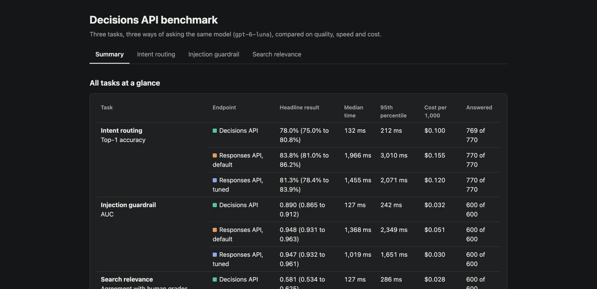

# Decisions API benchmark

A test of OpenAI's [Decisions API](https://developers.openai.com/api/docs/guides/decisions)
(`POST /v1/decisions`, model `gpt-6-luna`, in beta) on three tasks it should be good at, against
the Responses API on the same model.

This follows an [earlier test on skin-cancer images](https://github.com/pranavsaji/cancer-detection),
where the Decisions API was about 22 times faster but neither endpoint was accurate enough to judge.



## What is compared

| Endpoint | Call |
|---|---|
| Decisions API | typed questions, typed answers with probabilities |
| Responses API, default | the same question, answered as strict JSON at default settings |
| Responses API, tuned | the same, with reasoning effort set to `none` |

Every endpoint sees the same items, the same model and the same instructions. Calls are
interleaved through one worker pool so that all three see the same load.

| Task | Question type | Data | Items |
|---|---|---|---|
| Intent routing | `choice`, 77 options | Banking77 | 770 |
| Injection guardrail | `predicate` | deepset/prompt-injections, jackhhao/jailbreak-classification | 600 |
| Search relevance | `score`, 4 levels | TREC Deep Learning 2019 | 600 |

## Results

Run on 10 October 2026. Ranges are 95% intervals. Cost uses the token counts each call reported.

### Intent routing

| | Decisions API | Responses API, default | Responses API, tuned |
|---|---|---|---|
| Top-1 accuracy | 78.0% (75.0 to 80.8) | 83.8% (81.0 to 86.2) | 81.3% (78.4 to 83.9) |
| Top-3 accuracy | 89.2% (86.8 to 91.2) | 93.9% (92.0 to 95.4) | 92.6% (90.5 to 94.2) |
| Median response time | 132 ms | 1,966 ms | 1,454 ms |
| 95th-percentile response time | 212 ms | 3,010 ms | 2,071 ms |
| Cost per 1,000 decisions | $0.100 | $0.155 | $0.120 |
| Answered | 769 of 770 (1 refused, 0 malformed, 0 errors) | 770 of 770 | 770 of 770 |

### Injection guardrail

| | Decisions API | Responses API, default | Responses API, tuned |
|---|---|---|---|
| AUC | 0.890 (0.865 to 0.912) | 0.948 (0.931 to 0.963) | 0.947 (0.932 to 0.961) |
| Attacks caught at 1% false alarms | 75.0% (69.9 to 79.8) | 72.3% (67.5 to 77.4) | 71.0% (64.0 to 76.9) |
| Accuracy at 50% cut-off | 83.8% (80.7 to 86.6) | 83.0% (79.8 to 85.8) | 83.5% (80.3 to 86.3) |
| Median response time | 127 ms | 1,368 ms | 1,019 ms |
| 95th-percentile response time | 242 ms | 2,349 ms | 1,651 ms |
| Cost per 1,000 decisions | $0.032 | $0.051 | $0.030 |
| Answered | 600 of 600 | 600 of 600 | 600 of 600 |

### Search relevance

| | Decisions API | Responses API, default | Responses API, tuned |
|---|---|---|---|
| Agreement with human grades (weighted kappa) | 0.581 (0.534 to 0.625) | 0.580 (0.532 to 0.630) | 0.616 (0.565 to 0.666) |
| Exact grade matched | 43.3% (39.4 to 47.3) | 44.7% (40.7 to 48.7) | 46.3% (42.4 to 50.3) |
| Median response time | 127 ms | 1,692 ms | 1,332 ms |
| 95th-percentile response time | 286 ms | 2,527 ms | 2,232 ms |
| Cost per 1,000 decisions | $0.028 | $0.079 | $0.051 |
| Answered | 600 of 600 | 600 of 600 | 600 of 600 |

### What the results show

- **Speed is the clear win.** The Decisions API answered in a median of 127 to 132 ms on every
  task. That is 11 to 15 times faster than the default Responses API (1,368 to 1,966 ms) and 8 to
  11 times faster than the tuned one (1,019 to 1,454 ms). Turning reasoning off closes only about
  a quarter of the gap, so most of it is not reasoning overhead.
- **It lost on intent routing.** With 77 options, the Decisions API scored 78.0% top-1 against
  83.8% for the default Responses API, and the intervals do not overlap. Top-3 shows the same gap
  (89.2% against 93.9%). Against the tuned Responses API (81.3%) the intervals overlap.
- **Injection detection is mixed.** The Decisions API has a lower AUC (0.890 against 0.948 and
  0.947, intervals apart). At the operating points a guardrail would use, the three tie: 75.0%,
  72.3% and 71.0% of attacks caught at 1% false alarms, and 83.0% to 83.8% accuracy at the 50%
  cut-off. All three flag only about half of the deepset attacks (106 or 107 of 200) and no
  benign prompt.
- **Search relevance is a tie.** Weighted kappa is 0.581, 0.580 and 0.616, with overlapping
  intervals, at a fraction of the time and cost.
- **Cost is lower on two tasks, equal on one.** The Decisions API is cheapest on relevance
  ($0.028 against $0.079 and $0.051 per 1,000) and intent ($0.100 against $0.155 and $0.120). On
  injection it matches the tuned Responses API ($0.032 against $0.030), because it reported more
  input tokens for the same short text (323 against 225 on average).
- **All three were reliable.** Out of 5,910 calls there was one refusal (Decisions API, intent),
  no malformed answer and no API error.

### Limits of this test

- One prompt per task, written before the run, with no tuning.
- One model, one run, one day. Latency was measured from one machine with 8 parallel requests.
- The injection labels come from two community datasets with different ideas of what counts as
  an attack. Results are broken down by source in the dashboard.
- The relevance sample is drawn from judged passages that retrieval systems surfaced, not from
  all judged passages.
- Malformed answers count as wrong in accuracy figures. AUC, recall at 1% false alarms and kappa
  are computed on parsed answers only.
- The Decisions API is in beta and may change.

## Run it yourself

Requires [uv](https://docs.astral.sh/uv/) and an OpenAI API key with Decisions API access. The
full run cost about $0.45 at the prices read on 10 October 2026.

```bash
uv sync
cp .env.example .env                           # then add OPENAI_API_KEY=sk-...

uv run python -m tools.fetch                   # download and sample the datasets (no key needed)
uv run python -m bench.runner all --limit 20   # small paid smoke run
uv run python -m bench.runner all              # full run
uv run python -m bench.report                  # build results/*.json
uv run uvicorn app.server:app --port 8643      # open http://localhost:8643
uv run pytest                                  # unit tests
```

Every answer is cached under `.tmp/runs/`, so an interrupted run resumes without paying twice.
The dashboard reads the committed reports and works without an API key; only the playground
calls OpenAI.

## Layout

- `bench/tasks/`: one module per task with its question, Responses schema, parser and scorer
- `bench/endpoints.py`: the three API calls
- `bench/runner.py`: interleaved run with caching and retries
- `bench/metrics.py`, `bench/report.py`: statistics and report building
- `tools/fetch.py`: seeded dataset samples
- `app/`: FastAPI server and the dashboard

## Data and licence

Code is released under the [MIT licence](LICENSE).

- Banking77 (Casanueva et al., 2020), CC BY 4.0.
- deepset/prompt-injections and jackhhao/jailbreak-classification, from Hugging Face.
- TREC Deep Learning 2019 judgements over MS MARCO passages, which are provided for
  non-commercial research use.

The reports in `results/` include the sampled text so that the dashboard can show each case.
Check each dataset's terms before reusing it.
